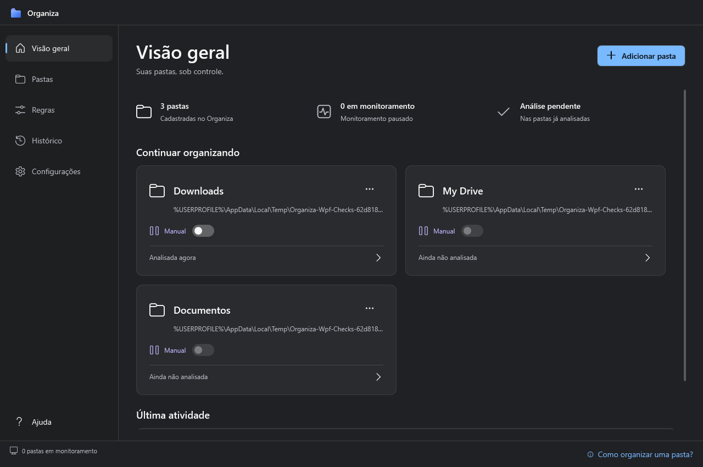
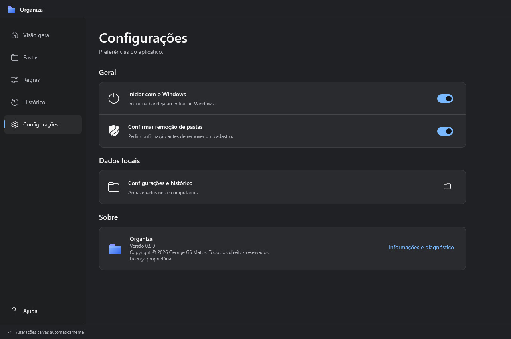

  
  <h1>Organiza</h1>
  
Organize suas pastas com regras, prévia e controle.

  
<a href="https://github.com/GeorgeGSMatos/Organiza/releases/latest">Baixar para Windows</a> · <a href="docs/instalacao.md">Instalação</a> · <a href="docs/desenvolvimento.md">Desenvolvimento</a> · <a href="https://github.com/GeorgeGSMatos/Organiza/issues">Suporte</a>

  

## Recursos

- Cadastre qualquer pasta acessível no Windows, com regras próprias.
- Analise destinos e sugestões antes de organizar os arquivos.
- Alterne entre organização manual e automática por pasta; o modo fica salvo.
- Revise arquivos sem regra, envie itens à Lixeira e consulte o histórico.
- Acompanhe o aplicativo pela bandeja e inicie com o Windows.

Interface nativa WPF, tema escuro, ícones consistentes e animações que respeitam as preferências do Windows. Ajuda contextual na navegação; versão e autoria em **Configurações → Sobre**.

## Interface

Capturas renderizadas dos controles reais com dados de teste. O desfoque do desktop depende da composição do Windows e não é reproduzido nestas imagens.

## Comece a usar

1. Baixe o pacote Windows x64 em [Releases](https://github.com/GeorgeGSMatos/Organiza/releases/latest).
2. Extraia **todo o ZIP** para uma pasta local e abra `Organiza.exe`.
3. Consulte o [guia de instalação e atualização](docs/instalacao.md) antes de substituir uma versão existente.

O pacote inclui os runtimes necessários. O motor de organização é local e não abre portas de rede.

## Compatibilidade e limites

- Windows 10/11 x64. Materiais nativos e desfoque dependem da versão e das configurações do Windows; há fundo sólido de fallback.
- Use primeiro uma pasta de teste e revise as regras. Pastas sincronizadas dependem também do provedor de sincronização.
- Os executáveis desta distribuição não têm assinatura digital de editor. Os hashes SHA-256 permitem conferir a integridade do download.

## Documentação

| Guia | Conteúdo |
| --- | --- |
| [Instalação](docs/instalacao.md) | Requisitos, atualização, bandeja e localização dos dados |
| [Desenvolvimento](docs/desenvolvimento.md) | Compilação e edição com perfil separado |
| [Arquitetura](docs/arquitetura.md) | Responsabilidades e integração com o Windows |
| [Validação](docs/validacao.md) | Comandos, testes e limites da cobertura |
| [Releases](docs/releases.md) | Versionamento, pacotes e publicação |
| [Changelog](CHANGELOG.md) | Evolução das versões |

## Suporte e segurança

Para bugs e sugestões, use os [modelos de issue](https://github.com/GeorgeGSMatos/Organiza/issues/new/choose). Remova nomes de usuário, caminhos pessoais e documentos das capturas e logs. Vulnerabilidades seguem a [política de segurança](SECURITY.md).

## Autoria e licença

Criado e mantido por **[George GS Matos](https://github.com/GeorgeGSMatos)**. Copyright © 2026. Todos os direitos reservados.

Este repositório tem **código visível e licença proprietária**; não é distribuído sob uma licença open source. Consulte [LICENSE.txt](LICENSE.txt), [EULA.txt](EULA.txt), [AUTHORS.md](AUTHORS.md) e [NOTICE.md](NOTICE.md). As permissões de visualização e fork da plataforma não equivalem a uma licença geral de reutilização. Contribuições seguem [CONTRIBUTING.md](CONTRIBUTING.md).
